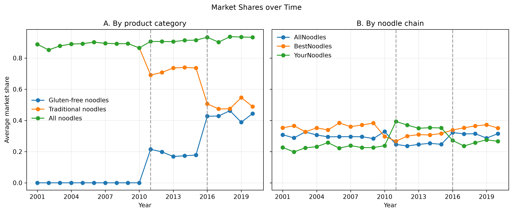
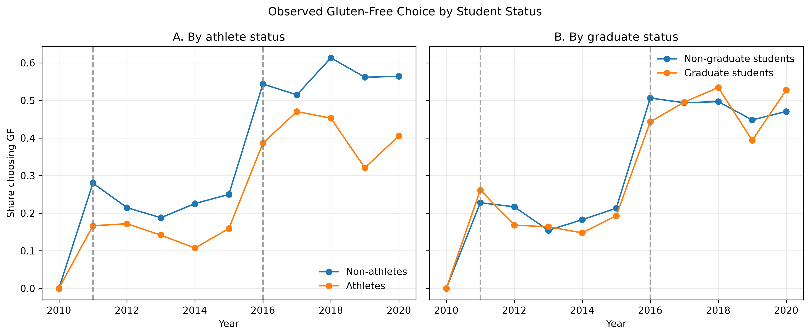
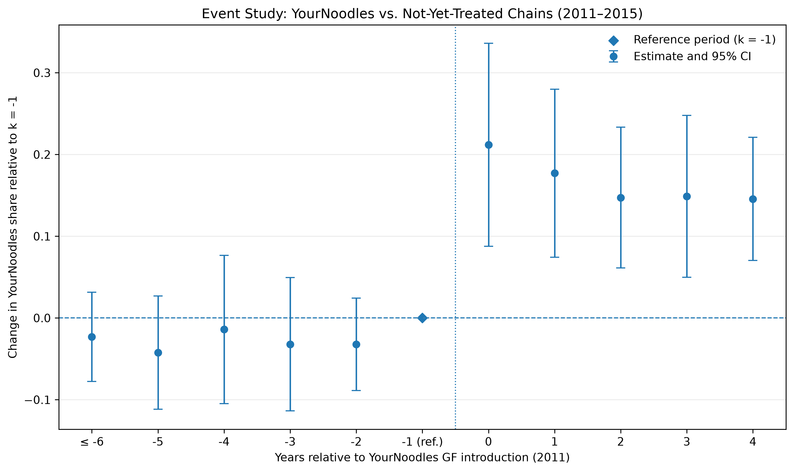

## Part 1: Empirical Evidence, Early Exhibits

# 2

Figure 1 Panel A documents the evolution of noodle market shares between 2001 and 2020. Traditional
noodles account for all of the observed noodles in the market before the introduction of gluten-free (GF) options
in 2011. Following their introduction, GF noodles gain market share, with a further increase around
2016, when additional chains begin offering GF alternatives. Over the same period, the market
share of traditional noodles declines. These patterns are consistent with a change in the composition
of noodle demand as GF alternatives become available, although the figure alone cannot establish
that their introduction caused the decline in traditional noodle shares. Panel B reproduces the same analysis by noodle chain. Since YourNoodles was the first to introduce GF options we observe its market share rising in 2011, but after all brands introduce it in 2016 it actually declines and others go up, suggesting BestNoodles and AllNoodles might have more attracting options at this point.

Figure 2 examines whether GF choices vary across student groups over time. The share of GF choices increases for both athletes and non-athletes, as well as for graduate students and non-graduates since the first introduction of a GF option in 2011, particularly after 2015. Non-athletes seem to consistently consume more GF options, while for Graduate vs non Graduate-students this relationship varies depending on the year. The overall patterns suggest potential heterogeneity in adoption patterns. However, these comparisons are descriptive and may also reflect changes in the composition of the surveyed students and campuses over time.

{#fig-market-shares-overview width=90% fig-pos="H"}

{#fig-gf-choice-student-status width=90% fig-pos="H"}

# 3

We present two main pricing regression exercises - and two complementary. Our main exercises refer to Regressions 1 and 4 (baseline versus adding cost and market shocks) but we also add intermediate results adding both sets of shocks individually to better assess their effect in the estimation.

**Regression 1 — Baseline**

$$
Price_{jmt} = \beta_0 + X_{jmt}'\beta + u_{jmt}.
$$

**Regression 2 — Market shocks**

$$
Price_{jmt} = \beta_0 + X_{jmt}'\beta + \gamma'C_{mt} + u_{jmt}.
$$

**Regression 3 — Input-cost shocks**

$$
Price_{jmt} = \beta_0 + X_{jmt}'\beta + \delta'Z_{jmt} + u_{jmt}.
$$

**Regression 4 — All cost shocks**

$$
Price_{jmt} = \beta_0 + X_{jmt}'\beta + \gamma'C_{mt} + \delta'Z_{jmt} + u_{jmt}.
$$

Here, $j$ identifies the product (brand and dish), $m$ the campus, and $t$ the
year. The vectors enter the specifications, and appear in the regression table,
in the following order:

- $X_{jmt} = (\text{SpicyIndex}, \text{WheatContent}, \text{Veg2meat}, \text{Calories})'$ contains the observed product characteristics.
- $C_{mt} = (\text{WageIDX}, \text{ReEsIDX})'$ contains market-level cost shifters: the local wage and real-estate indices.
- $Z_{jmt} = (\text{wheat\_shock}, \text{vegetable\_shock}, \text{meat\_shock})'$ contains product-market-specific input-cost shocks, constructed from local input prices and the product's exposure to wheat, vegetables, and meat.

The vectors $\beta$, $\gamma$, and $\delta$ are the corresponding coefficient
vectors, and $u_{jmt}$ is the unobserved component of price. Standard errors
are heteroskedasticity robust (HC1), so all estimates are interpreted as
conditional associations rather than causal effects.

Table 1 reports regression results. Column (1) shows the OLS relationship between menu prices and product characteristics. Since prices may be correlated with unobserved product characteristics, we interpret the coefficients as conditional associations rather than causal effects. Wheat content is positively and statistically significantly associated with price, whereas the coefficients on spiciness, vegetable-to-meat ratio, and calories are not statistically significant. Advancing to columns (2), (3), and (4) regression results suggest that both market-level cost shifters and product-market-specific input-cost shocks contribute to explaining price variation - separately and together. In all specifications shocks are jointly statistically significant at the 1% level in F-stat tests. Comparing the F-stats within specifications results suggest that product-market-specific input-cost shocks account for a larger share of the variation explained by the pricing regressions than market-level cost shifters alone. However, these results establish explanatory relevance in the pricing regressions, not instrument strength in the demand estimation or instrument exogeneity. The latter requires further assessment in the instrumental-variables estimation and an economic justification for the exclusion restrictions.

\begin{table}[H]
\centering
\scriptsize
\caption{Pricing Regressions with Market and Input-Cost Shocks}
\label{tab:pricing-regressions-comparison}
\renewcommand{\arraystretch}{1.2}
\begin{tabular}{lcccc}
\hline
Variable & (1) Baseline & (2) Market shocks & (3) Input-cost shocks & (4) All cost shocks \\
\hline
const & \begin{tabular}[c]{@{}c@{}}0.6757***\\(0.1641)\end{tabular} & \begin{tabular}[c]{@{}c@{}}0.2798*\\(0.1646)\end{tabular} & \begin{tabular}[c]{@{}c@{}}0.7465***\\(0.1363)\end{tabular} & \begin{tabular}[c]{@{}c@{}}0.3776***\\(0.1336)\end{tabular} \\
SpicyIndex & \begin{tabular}[c]{@{}c@{}}-0.0419\\(0.0557)\end{tabular} & \begin{tabular}[c]{@{}c@{}}-0.0296\\(0.0537)\end{tabular} & \begin{tabular}[c]{@{}c@{}}-0.0196\\(0.0464)\end{tabular} & \begin{tabular}[c]{@{}c@{}}-0.0082\\(0.0442)\end{tabular} \\
WheatContent & \begin{tabular}[c]{@{}c@{}}0.6555***\\(0.0619)\end{tabular} & \begin{tabular}[c]{@{}c@{}}0.6731***\\(0.0582)\end{tabular} & \begin{tabular}[c]{@{}c@{}}-0.2233***\\(0.0624)\end{tabular} & \begin{tabular}[c]{@{}c@{}}-0.1955***\\(0.0576)\end{tabular} \\
Veg2meat & \begin{tabular}[c]{@{}c@{}}0.0667\\(0.1065)\end{tabular} & \begin{tabular}[c]{@{}c@{}}0.0555\\(0.1021)\end{tabular} & \begin{tabular}[c]{@{}c@{}}-0.2678**\\(0.1051)\end{tabular} & \begin{tabular}[c]{@{}c@{}}-0.2638***\\(0.1001)\end{tabular} \\
Calories & \begin{tabular}[c]{@{}c@{}}-0.0166\\(0.1809)\end{tabular} & \begin{tabular}[c]{@{}c@{}}0.0218\\(0.1747)\end{tabular} & \begin{tabular}[c]{@{}c@{}}-0.0999\\(0.1473)\end{tabular} & \begin{tabular}[c]{@{}c@{}}-0.0598\\(0.1410)\end{tabular} \\
WageIDX & --- & \begin{tabular}[c]{@{}c@{}}0.1750***\\(0.0177)\end{tabular} & --- & \begin{tabular}[c]{@{}c@{}}0.1711***\\(0.0175)\end{tabular} \\
ReEsIDX & --- & \begin{tabular}[c]{@{}c@{}}0.0515***\\(0.0182)\end{tabular} & --- & \begin{tabular}[c]{@{}c@{}}0.0365**\\(0.0143)\end{tabular} \\
wheat\_shock & --- & --- & \begin{tabular}[c]{@{}c@{}}0.6989***\\(0.0310)\end{tabular} & \begin{tabular}[c]{@{}c@{}}0.6899***\\(0.0288)\end{tabular} \\
vegetable\_shock & --- & --- & \begin{tabular}[c]{@{}c@{}}0.2175***\\(0.0407)\end{tabular} & \begin{tabular}[c]{@{}c@{}}0.2051***\\(0.0395)\end{tabular} \\
meat\_shock & --- & --- & \begin{tabular}[c]{@{}c@{}}-0.0004\\(0.0015)\end{tabular} & \begin{tabular}[c]{@{}c@{}}-0.0005\\(0.0015)\end{tabular} \\
\hline
Observations & 2690 & 2690 & 2690 & 2690 \\
R-squared & 0.0479 & 0.1490 & 0.2918 & 0.3861 \\
F-statistic (included shocks) & --- & 50.45 & 176.03 & 145.48 \\
F-test p-value & --- & <0.001 & <0.001 & <0.001 \\
\hline
\end{tabular}

\vspace{0.3em}
\parbox{0.95\textwidth}{\scriptsize \textit{Notes:} Dependent variable: price. Heteroskedasticity-robust standard errors are in parentheses. The F-test tests whether the shocks included in each specification are jointly equal to zero. * $p<0.10$, ** $p<0.05$, *** $p<0.01$.}
\end{table}

#### Reduced-Form Estimations

For our reduced form exhibits we begin wit @fig-event-study which reports the event-study estimates around the
introduction of gluten-free options. The following figures then describe market
shares overall and heterogeneity in observed gluten-free choices.

To obtain quasi-experimental variation in gluten-free (GF) availability, we exploit the staggered adoption across chains: YourNoodles introduced GF in 2011 in all campuses, while AllNoodles and BestNoodles only did so in 2016. A two-way event study using all years would lack a clean control group after 2016, when every chain is treated. We therefore restrict the sample to 2001–2015, where AllNoodles and BestNoodles serve as not-yet-treated controls. We regress chain-campus-year market share on event-time indicators for YourNoodles (reference period k = −1), with chain fixed effects and campus-by-year fixed effects, clustering standard errors by campus. The campus-year fixed effects absorb any shock common to all chains in a market.

The pre-adoption coefficients are small and statistically indistinguishable from zero, supporting parallel trends. After 2011, YourNoodles’ share rises by about 0.21 on impact and settles at roughly 0.15 over the following years, with all post-period coefficients significant. This is a relative effect: it measures YourNoodles’ share against the other chains in the same campus-year, not the aggregate effect of GF on total noodle consumption.

{#fig-event-study width=82% fig-pos="H"}

On another exhibit, Table 2 documents substitution patterns across chains and product categories. Among respondents whose observed choice was gluten-free, the share reporting a traditional noodle dish as their hypothetical second choice ranges from 54.7% for AllNoodles to 80.8% for YourNoodles. Conversely, among respondents whose observed choice was traditional, 24.5%–31.8% report a gluten-free dish as their second choice, depending on the chain. These patterns suggest that gluten-free and traditional noodles can be substitutes, but the extent of substitution varies across chains. They also indicate that product category alone does not fully characterize consumers' second-choice patterns. Since these are stated hypothetical choices, they should not be interpreted as actual switching behavior or as direct estimates of substitution following the removal of all gluten-free products.

| Observed choice | Second choice: GF | Second choice: Traditional | N |
|:--|--:|--:|--:|
| AllNoodles -- GF | 45.3% | 54.7% | 752 |
| AllNoodles -- Traditional | 31.8% | 68.2% | 2,382 |
| BestNoodles -- GF | 39.4% | 60.6% | 836 |
| BestNoodles -- Traditional | 27.3% | 72.7% | 2,750 |
| YourNoodles -- GF | 19.2% | 80.8% | 1,527 |
| YourNoodles -- Traditional | 24.5% | 75.5% | 1,784 |

: Second-Choice Summary by Chain {#tbl-second-choice-summary}

