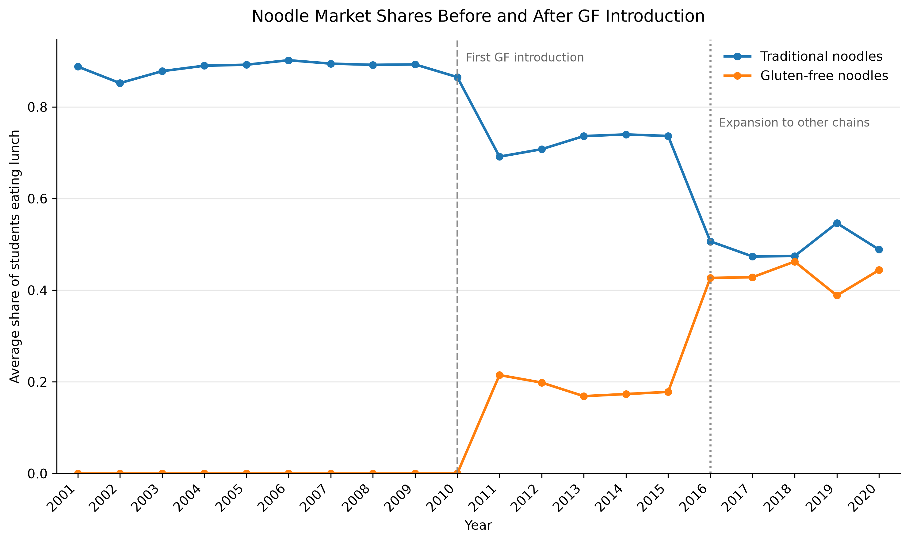
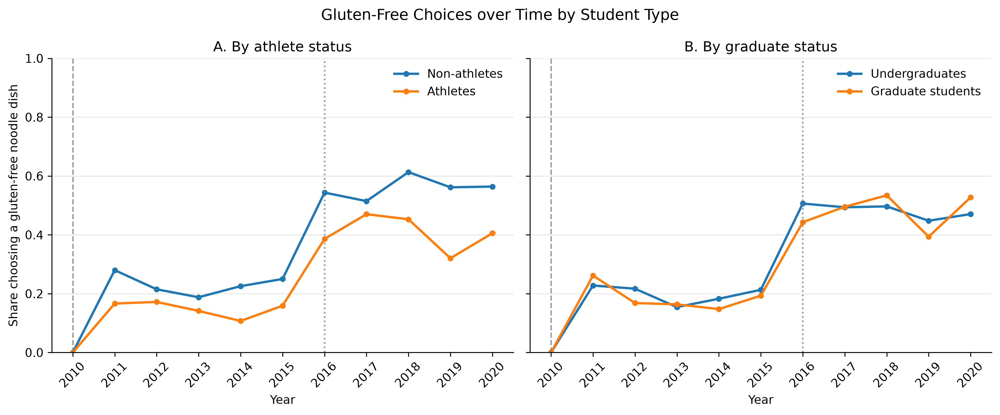

<!--
Render this document from the repository root with:

    quarto render pset_2/pset_2_submission.qmd --to pdf

The resulting PDF is written next to this file.
-->

## Part 0: Empirical Target

### Object of Interest

Our main empirical objective is to \textbf{quantify the welfare gains associated with the availability of gluten-free noodle options on college campuses}. Specifically, we aim to estimate the change in student welfare relative to a counterfactual market in which none of the chains offers gluten-free options. In addition to estimating the average welfare gain across students, we aim to characterize how these gains vary across student groups, particularly athletes and graduate students.

More precisely, our object of interest is the change in consumer surplus resulting from the introduction of gluten-free options, both on average and separately across groups defined by students' observable characteristics. This allows us to assess not only the overall benefits of expanding the available choice set, but also how these benefits are distributed across different types of students.

### Demand Estimation and Consumer Preferences

To quantify these welfare gains, we will estimate a discrete-choice demand model based on a random utility framework. Student utility will depend on product prices and observable characteristics, such as spiciness, wheat content, the vegetable-to-meat ratio, and calories, as well as unobserved product and consumer characteristics.

We will begin with the logit specifications in Part II and then allow for heterogeneous preferences through random-coefficient models in Part III. These specifications will help us characterize how students trade off prices and product characteristics, as well as how preferences vary across students with different observable characteristics, particularly athletes and graduate students.

### Price Variation and Product Substitution

A key challenge is that observed prices may be endogenous if stores adjust prices in response to unobserved product attractiveness. We will therefore investigate whether local input-cost shocks provide suitable instruments for product prices. Specifically, variation in local prices of wheat, vegetables, and meat, combined with differences in product composition, may generate exogenous variation in production costs and help identify price sensitivity.

We will also characterize substitution patterns across products. Observed market shares will inform the estimation of demand, while the hypothetical second-choice responses in the survey can provide additional information on substitution between alternatives. These data may improve our understanding of how students would reallocate their choices if gluten-free products were unavailable.

### Counterfactual and Welfare Measurement

Using the estimated demand model, we will simulate a counterfactual in which all gluten-free products are removed from the choice set, while the prices and characteristics of the remaining products are held constant. Holding the prices of the remaining products fixed is a simplifying assumption that isolates the direct welfare effect of expanding the available choice set and facilitates computation. It abstracts from potential equilibrium price adjustments following the introduction or removal of gluten-free products.

We will measure welfare changes using the model-implied change in consumer surplus, accounting for the estimated price sensitivity and, where applicable, heterogeneity in preferences. Finally, we will examine heterogeneity in welfare gains across student groups, particularly athletes and graduate students. Comparing results across the logit and random-coefficient specifications will allow us to assess how assumptions about preference heterogeneity affect the estimated benefits of gluten-free options.

## Part 1: Empirical Evidence, Early Exhibits

#### Data Patterns

Figure 1 documents the evolution of noodle market shares between 2001 and 2020. Traditional noodles account for the majority of the market before the introduction of gluten-free (GF) options in 2011. Following their introduction, GF noodles gain market share, with a further increase around 2016, when additional chains begin offering GF alternatives. Over the same period, the market share of traditional noodles declines. These patterns are consistent with a change in the composition of noodle demand as GF alternatives become available, although the figure alone cannot establish that their introduction caused the decline in traditional noodle shares.

Related to that, Figure 2 examines whether GF choices vary across student groups over time. The share of GF choices increases for both athletes and non-athletes, as well as for graduate students and undergraduates, particularly after 2015. The differences between groups vary across years, suggesting potential heterogeneity in adoption patterns. However, these comparisons are descriptive and may also reflect changes in the composition of the surveyed students and campuses over time.

{#fig-market-shares-evolution width=70% fig-pos="H"}

{#fig-choices-by-student width=80% fig-pos="H"}

##### Pricing regressions

Now we procede to show results of pricing regressions. Our main exercises refer to Regressions 1 and 4 (baseline versus adding cost and market shocks) but we also add intermediate results adding both sets of shocks individually to better assess their effect in the estimation.

**Regression 1 — Baseline**

$$
Price_{jmt} = \beta_0 + X_{jmt}'\beta + u_{jmt}.
$$

**Regression 2 — Market shocks**

$$
Price_{jmt} = \beta_0 + X_{jmt}'\beta + \gamma'C_{mt} + u_{jmt}.
$$

**Regression 3 — Input-cost shocks**

$$
Price_{jmt} = \beta_0 + X_{jmt}'\beta + \delta'Z_{jmt} + u_{jmt}.
$$

**Regression 4 — All cost shocks**

$$
Price_{jmt} = \beta_0 + X_{jmt}'\beta + \gamma'C_{mt} + \delta'Z_{jmt} + u_{jmt}.
$$

Here, $j$ identifies the product (brand and dish), $m$ the campus, and $t$ the
year. The vectors enter the specifications, and appear in the regression table,
in the following order:

- $X_{jmt} = (\text{SpicyIndex}, \text{WheatContent}, \text{Veg2meat}, \text{Calories})'$ contains the observed product characteristics.
- $C_{mt} = (\text{WageIDX}, \text{ReEsIDX})'$ contains market-level cost shifters: the local wage and real-estate indices.
- $Z_{jmt} = (\text{wheat\_shock}, \text{vegetable\_shock}, \text{meat\_shock})'$ contains product-market-specific input-cost shocks, constructed from local input prices and the product's exposure to wheat, vegetables, and meat.

The vectors $\beta$, $\gamma$, and $\delta$ are the corresponding coefficient
vectors, and $u_{jmt}$ is the unobserved component of price. Standard errors
are heteroskedasticity robust (HC1), so all estimates are interpreted as
conditional associations rather than causal effects.

Table 1 reports regression results. Column (1) shows the OLS relationship between menu prices and product characteristics. Since prices may be correlated with unobserved product characteristics, we interpret the coefficients as conditional associations rather than causal effects. Wheat content is positively and statistically significantly associated with price, whereas the coefficients on spiciness, vegetable-to-meat ratio, and calories are not statistically significant. Advancing to columns (2) and (3) regression results suggest that both market-level cost shifters and product-market-specific input-cost shocks contribute to explaining price variation. Adding wage and real-estate indices increases the R-squared from 0.055 to 0.163, while adding input-cost shocks alone raises it to 0.308. Both sets of shocks are jointly statistically significant at the 1% level. When included together, the R-squared reaches 0.404.
These results suggest that product-market-specific input-cost shocks account for a larger share of the variation explained by the pricing regressions than market-level cost shifters alone. The increase in explanatory power when both sets are included also suggests that they provide complementary information about prices.

 However, these results establish explanatory relevance in the pricing regressions, not instrument strength in the demand estimation or instrument exogeneity. The latter requires further assessment in the instrumental-variables estimation and an economic justification for the exclusion restrictions.

 
\begin{table}[H]
\centering
\scriptsize
\caption{Pricing Regressions with Market and Input-Cost Shocks}
\label{tab:pricing-regressions-comparison}
\renewcommand{\arraystretch}{1.2}
\begin{tabular}{lcccc}
\hline
Variable & (1) Baseline & (2) Market shocks & (3) Input-cost shocks & (4) All cost shocks \\
\hline
const & \begin{tabular}[c]{@{}c@{}}0.6768***\\(0.1894)\end{tabular} & \begin{tabular}[c]{@{}c@{}}0.2821\\(0.1894)\end{tabular} & \begin{tabular}[c]{@{}c@{}}0.7605***\\(0.1547)\end{tabular} & \begin{tabular}[c]{@{}c@{}}0.4085***\\(0.1504)\end{tabular} \\
SpicyIndex & \begin{tabular}[c]{@{}c@{}}-0.0622\\(0.0630)\end{tabular} & \begin{tabular}[c]{@{}c@{}}-0.0463\\(0.0608)\end{tabular} & \begin{tabular}[c]{@{}c@{}}-0.0264\\(0.0519)\end{tabular} & \begin{tabular}[c]{@{}c@{}}-0.0111\\(0.0496)\end{tabular} \\
WheatContent & \begin{tabular}[c]{@{}c@{}}0.7055***\\(0.0699)\end{tabular} & \begin{tabular}[c]{@{}c@{}}0.7309***\\(0.0651)\end{tabular} & \begin{tabular}[c]{@{}c@{}}-0.1676**\\(0.0696)\end{tabular} & \begin{tabular}[c]{@{}c@{}}-0.1235*\\(0.0638)\end{tabular} \\
Veg2meat & \begin{tabular}[c]{@{}c@{}}0.0755\\(0.1209)\end{tabular} & \begin{tabular}[c]{@{}c@{}}0.0492\\(0.1155)\end{tabular} & \begin{tabular}[c]{@{}c@{}}-0.3255***\\(0.1218)\end{tabular} & \begin{tabular}[c]{@{}c@{}}-0.3531***\\(0.1151)\end{tabular} \\
Calories & \begin{tabular}[c]{@{}c@{}}-0.0225\\(0.2088)\end{tabular} & \begin{tabular}[c]{@{}c@{}}0.0038\\(0.2017)\end{tabular} & \begin{tabular}[c]{@{}c@{}}-0.0838\\(0.1669)\end{tabular} & \begin{tabular}[c]{@{}c@{}}-0.0546\\(0.1604)\end{tabular} \\
WageIDX & --- & \begin{tabular}[c]{@{}c@{}}0.1753***\\(0.0200)\end{tabular} & --- & \begin{tabular}[c]{@{}c@{}}0.1688***\\(0.0199)\end{tabular} \\
ReEsIDX & --- & \begin{tabular}[c]{@{}c@{}}0.0547***\\(0.0196)\end{tabular} & --- & \begin{tabular}[c]{@{}c@{}}0.0338**\\(0.0151)\end{tabular} \\
wheat\_shock & --- & --- & \begin{tabular}[c]{@{}c@{}}0.6815***\\(0.0319)\end{tabular} & \begin{tabular}[c]{@{}c@{}}0.6658***\\(0.0293)\end{tabular} \\
vegetable\_shock & --- & --- & \begin{tabular}[c]{@{}c@{}}0.2351***\\(0.0481)\end{tabular} & \begin{tabular}[c]{@{}c@{}}0.2341***\\(0.0472)\end{tabular} \\
meat\_shock & --- & --- & \begin{tabular}[c]{@{}c@{}}-0.0031\\(0.0019)\end{tabular} & \begin{tabular}[c]{@{}c@{}}-0.0035**\\(0.0017)\end{tabular} \\
\hline
Observations & 2150 & 2150 & 2150 & 2150 \\
R-squared & 0.0550 & 0.1625 & 0.3082 & 0.4039 \\
F-statistic (included shocks) & --- & 40.57 & 161.39 & 132.19 \\
F-test p-value & --- & <0.001 & <0.001 & <0.001 \\
\hline
\end{tabular}

\vspace{0.3em}
\parbox{0.95\textwidth}{\scriptsize \textit{Notes:} Dependent variable: price. Heteroskedasticity-robust standard errors are in parentheses. The F-test tests whether the shocks included in each specification are jointly equal to zero. * $p<0.10$, ** $p<0.05$, *** $p<0.01$.}
\end{table}